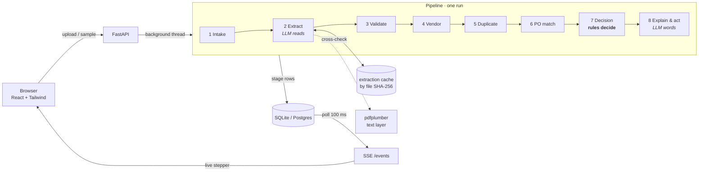

# Invoice Agent

A working invoice-processing agent for accounts payable. Drop in a vendor invoice PDF (digital **or** scanned) and watch it move through eight visible stages to a reasoned decision — **Approve / Pending / Reject** — with every check, number and rule behind it on screen.

> **AI reads and explains. Code decides.**
> A language model turns messy PDFs into structured fields and, afterwards, words the explanation. Every validation, calculation, match, tolerance and the final decision is plain, deterministic Python with rule IDs. The model never decides and never does money arithmetic. *Approve* is a **recommendation to post for payment** — the system never releases money.

  

---

## Run it

**Two commands (needs Python 3.11+ and Node 20+):**

```bash
cd backend && pip install -r requirements.txt && cd ../frontend && npm install && npm run build && cd ../backend && uvicorn app.main:app --port 8000
```
Open <http://localhost:8000>. The first start creates the database and seeds master data plus three historical invoices.

**Or with Docker (app + Postgres):**

```bash
docker compose up --build
```

**Frontend dev mode** (hot reload, proxies `/api` to :8000): `cd frontend && npm run dev` → <http://localhost:5173>

| Env var | Default | Meaning |
|---|---|---|
| `LLM_MODE` | `cached` | `cached`: use the pre-warmed extraction for a known file, call the API only on a miss. `live`: always call the API (falls back to the cache only if the call fails). |
| `ANTHROPIC_API_KEY` | – | Needed for `live`, for new files that are not in the cache, and for LLM-written explanations. |
| `GEMINI_API_KEY` (or `GOOGLE_API_KEY`) | – | Google AI Studio key — the same purpose as `ANTHROPIC_API_KEY`, using Gemini instead. If both are set, Anthropic wins unless `LLM_PROVIDER=gemini`. |
| `LLM_PROVIDER` | auto | `gemini` or `anthropic`; auto-detected from whichever key is present. |
| `LLM_MODEL` | `gemini-3.5-flash-lite` / `claude-sonnet-5-5` | Model id for the chosen provider. |
| `DATABASE_URL` | local SQLite | Postgres in production (`postgres://` URLs are accepted). |
| `APP_PASSWORD` | – | Optional. Puts the whole site behind a shared password (HTTP basic auth, any username). |
| `STAGE_DELAY_MS` | `450` | Cosmetic pause between stages so the live stepper is watchable. `0` to disable. |

### About the extraction cache
Cached extractions live in `backend/llm_cache/<sha256-of-file>.json`. The ones committed here for the eleven sample PDFs are **real model output** — `gemini-3.5-flash-lite` reading each PDF (`python scripts_warm_cache.py --live`), not hand-written data. In the UI they are labelled *"LLM (cached)"*; with `LLM_MODE=live` a fresh call is labelled *"LLM (live)"*. Because the cache is keyed by the file's SHA-256, the demo is deterministic and works even when the API is slow or down.

* **Re-generate** (e.g. after changing the prompt or model): `export GEMINI_API_KEY=...` (or `ANTHROPIC_API_KEY`), then `cd backend && python scripts_warm_cache.py --live --force`, then `python scripts_run_samples.py` — all eight scenarios should still match their expected decisions. Without `--force`, files that already have a real extraction are skipped, so you can re-run after a temporary API error (e.g. a 503).
* **Without an API key, a PDF that is not in the cache cannot be read**: an unseen upload goes to **Pending** with "No cached extraction exists for this file and no LLM API key…". Add `GEMINI_API_KEY` to read arbitrary invoices.
* `python scripts_warm_cache.py --seed` still exists to restore the generator's ground-truth extractions (labelled *"Pre-recorded extraction"*) — useful for offline tests of the rules, not for a demo.
* Free-tier note: `gemini-3.5-flash-lite` allows about 15 requests/minute and 500/day; each processed invoice also makes one short call for its explanation (served from the cache for the sample set).

---

## Architecture



* Every stage writes a row (`running → passed | warning | failed`, duration, summary, check results) the moment it starts and finishes. The SSE endpoint replays those rows and follows new ones, so the live view also works if you open a finished run, refresh mid-run, or run behind a proxy.
* The pipeline never crashes a run: an exception in a stage marks it `failed`, adds a `SYS` check, and the run lands in **Pending** with *"Processing error at stage X: …"*.
* Money is `Decimal` end to end and stored as strings; there is no float arithmetic on amounts.

## The eight stages

| # | Stage | What happens |
|---|---|---|
| 1 | **Intake** | SHA-256, page count, text layer or image-only |
| 2 | **Extract** | Model reads the PDF through a forced tool call (strict JSON, per-field confidence). Code normalises dates/amounts/invoice numbers and **cross-checks** invoice no., total, subtotal and GSTIN against the PDF's own text layer (R02) |
| 3 | **Validate** | Required fields, line math, totals, GST structure, positive total (R01, R03, R04, R15) |
| 4 | **Vendor** | GSTIN exact → fuzzy name + aliases; bank details vs master (R05, R06) |
| 5 | **Duplicate** | Exact and fuzzy duplicate against earlier non-rejected invoices (R07, R08) |
| 6 | **PO match** | Resolve or **infer** the PO; line price; **3-way** match against goods receipts; **cumulative** billing (R09–R14) |
| 7 | **Decision** | Precedence engine over all checks; returns *every* rule that fired |
| 8 | **Explain & act** | 2–4 sentence plain-English explanation from the check results only, plus a draft next action (email/phone script). Nothing is sent automatically |

## Rules

| ID | Check | If it fails |
|---|---|---|
| R01 | Required fields present | Pending |
| R02 | Extraction confidence ≥ 80 % and text-layer cross-check agrees | Pending |
| R03 | Line math and totals reconcile (±₹1) | Pending |
| R04 | GST structure: CGST = SGST *or* IGST alone, matches place of supply, tax = rate × base | Pending |
| R05 | Vendor in master (GSTIN, or name ≥ 92 %) | Unknown → **Reject**; 80–92 % → Pending |
| R06 | Bank details match the master | **Pending · security hold** |
| R07 | Same vendor, same invoice number already processed | **Reject** |
| R08 | Probable duplicate (same vendor + total + date window + similar number, or same file) | High → **Reject**; medium → Pending |
| R09/R10 | PO exists and belongs to the vendor; otherwise infer from the vendor's open POs | Pending (suggestion shown) |
| R11 | Unit price within ±1 % of PO | Pending |
| R12 | 3-way: billed ≤ received − already billed (goods only) | Pending |
| R13 | Approved-to-date + this invoice ≤ PO value | Pending |
| R14 | Currency matches PO | Pending |
| R15 | Total > 0 | **Reject** |

**Precedence:** any reject rule → Reject. Else any security hold → Pending (security). Else any pending rule → Pending. Else Approve. Tolerances are in [`backend/app/config.py`](backend/app/config.py) and shown on the **Master data → Rules** page.

## Scenarios (the demo set)

| File | Scenario | Result |
|---|---|---|
| `01_happy_sgi_0418` | Goods, 3-way match, intra-state GST | **Approve** |
| `02_happy_nimbus_0091` | Service, 2-way match, different layout, inter-state IGST | **Approve** |
| `03a`/`03b` `_split_apex` | **Edge 1** – one PO billed across several invoices (48 + 42 of 120 units) | **Approve** each |
| `03c_split_apex_1103` | 33 units billed, only 30 left → R12 + R13 (over by 3 units / ₹1,500) | **Pending** |
| `04_implied_po_kaveri_2231` | **Edge 2** – no PO number, only "your order dated 02-Oct-2026". Suggests PO-2026-1003; the same-value PO-2026-1009 of another vendor is shown as *excluded*. "Confirm PO" → | Pending → **Approve** |
| `05_dup_sgi_0418_scan` | **Edge 3** – image-only scan of invoice 01, number re-typed `INVSGI418`, later date. File hash differs, literal number differs → caught by R08 | **Reject** |
| `06_bankchange_orbit_7782` | **Edge 4** – everything matches except the bank account (+ "new bank details" note) | **Pending · security hold** |

Order matters: 01 before 05; 03a → 03b → 03c. Use **Reset demo** (header) to wipe runs and start clean.

## API

```
POST /api/runs               multipart file  OR  {"sample": "01_happy_sgi_0418.pdf"}  → {run_id}
GET  /api/runs/{id}/events   SSE stage stream (replays past events, then follows)
GET  /api/runs/{id}          full run: file meta, extraction, checks per stage, line matches, PO balance, decision, explanation, next action, audit
GET  /api/runs               filters: status, vendor, q, date_from, date_to, page, page_size
POST /api/runs/{id}/actions  {type: approve|reject|confirm_po|rerun, po_id?, reason?}
GET  /api/runs/{id}/file     the original PDF
GET  /api/dashboard/stats    KPIs, top exception reasons, ₹ by status
GET  /api/master/{vendors|pos|grns}   GET /api/samples   GET /api/config   POST /api/demo/reset   GET /api/health
```

## Tests

```bash
cd backend && pytest -q        # 53 tests, offline, deterministic (LLM_MODE=cached, no network)
python scripts_run_samples.py  # runs all 8 scenarios in demo order and prints decision vs expectation
```
One test per scenario (decision **and** the rule IDs that fired), plus unit tests for invoice-number normalisation, fuzzy duplicates, PO-inference scoring, GST validation, Decimal rounding, the precedence engine (synthetic checks, no PDFs) and a guard-rail that every number in an explanation or draft email traces back to a check result.

## Deploy

`render.yaml` is a Render blueprint (Docker web service + managed Postgres). Create it from the repo, add `GEMINI_API_KEY` (required to read any PDF that is not one of the cached samples — without it, unseen uploads go to Pending) and optionally `APP_PASSWORD` in the dashboard, then open the URL; master data and history are seeded on first boot. The same image runs on Railway or anywhere that provides `$PORT` and `DATABASE_URL`.

## Why it is built this way (for a finance buyer)

* **Predictable and auditable.** The same invoice always gets the same decision, and every decision lists the rule IDs and the evidence values (expected vs actual) behind it.
* **The AI is boxed in.** It reads and it writes prose; it cannot approve anything. Its explanation is rejected and replaced by a template if it contains a number that is not in the check results.
* **A second opinion on reading.** Key fields are cross-checked against the PDF's own text layer; disagreement lowers confidence and holds the invoice.
* **Fraud signals are first-class.** A changed bank account is never auto-approved, and the suggested follow-up is to call the vendor on the number *on file*, not the one on the invoice.
* **Humans stay in control.** Overrides need a reason and are written to an audit log with actor and time; the system's own decision is always preserved next to the override.

## Limitations and next steps
GL coding and cost-centre assignment · approval matrix by amount · payment runs and bank files · multi-currency / FX · credit notes and debit notes · email-inbox intake · ERP / procurement integration (live PO and GRN data instead of CSV master data) · real authentication and roles (today: one optional shared password) · multi-page invoices with attachments · OCR-quality benchmarking on a larger real-world corpus.


